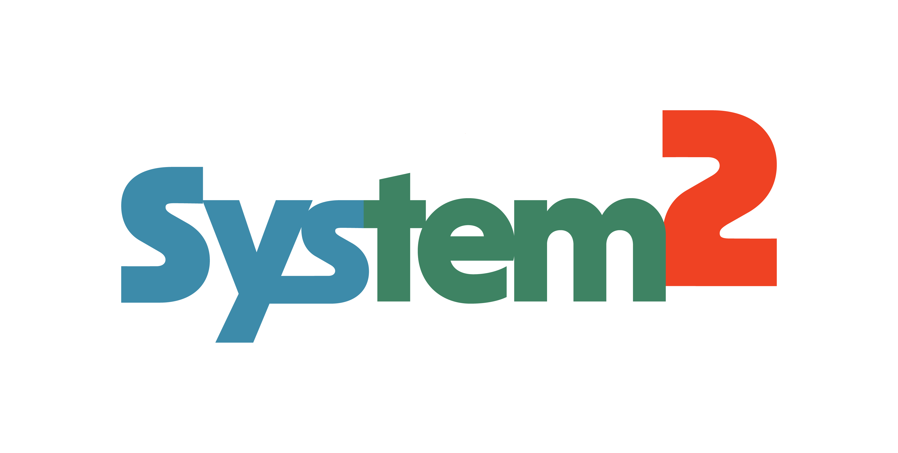
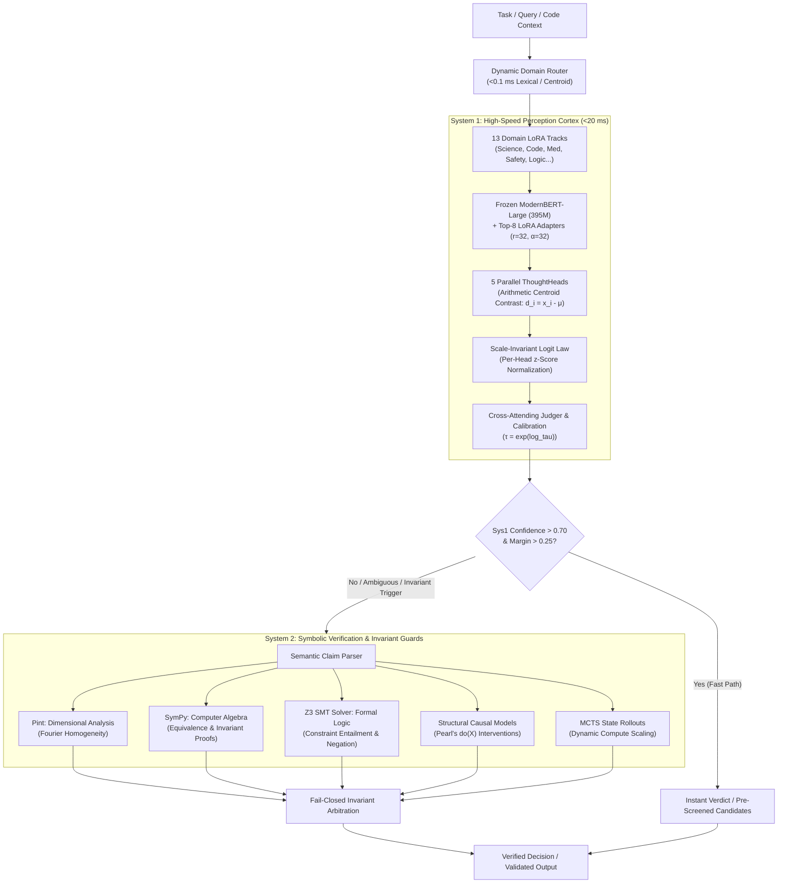

<p align="center">
  
</p>

<h1 align="center">System2: Sovereign Dual-Process Cognitive AI Architecture</h1>

<p align="center">
  <em>"Remember, your data lives with you now."</em>
</p>

<p align="center">
  <a href="LICENSE"></a>
  =3.10">
  
  <a href="https://github.com/system2-labs/system2-agent"></a>
  <a href="https://huggingface.co/System2-Online"></a>
  <a href="https://github.com/system2-labs/System2"></a>
</p>

---

## The System2 Statement

Autoregressive Large Language Models generate tokens sequentially, improvising without deliberation. When forced to reason purely through internal text generation (chain-of-thought `<think>` loops), they remain fragile: low-precision quantized weights compound token noise into semantic collapse, hallucinations cascade across steps, and models express uncalibrated overconfidence in flawed answers.

**System2** realizes Daniel Kahneman's Dual-Process Cognitive Theory in software. Instead of relying on monolithic autoregressive generation, System2 decouples reasoning into two complementary, mathematically grounded engines:

$$\text{Verdict} = \text{System 2}_{\text{Symbolic}}(\text{System 1}_{\text{Perception}}(\text{Context}, \text{Candidates}))$$

1. **System 1 (Perception & Triage)**: A lightning-fast, non-autoregressive neural engine running in **`< 20 ms`** on Apple Silicon GPU (< 200 ms on CPU). It classifies domain intents across 13 specialized tracks, eliminates improbable candidate branches, extracts contrastive representations, and enforces the **Regime 2 Protocol** (`thinking: off` on low-bit weights).
2. **System 2 (Symbolic Verification & Deliberation)**: A deterministic, external symbolic execution harness. Instead of guessing inside token loops, System 2 executes formal AST invariant checks, verifies physical dimensions and Fourier homogeneity (Pint), checks algebraic equivalence (SymPy), validates propositional logic and SMT constraints (Z3), simulates Structural Causal Models (Pearl's do-calculus), and drives dynamic compute scaling via Monte Carlo Tree Search (MCTS).

The result is **sovereign, air-gapped, frontier-quality deliberation** running locally on a standard 16 GB laptop with **$0 marginal token cost**.

---

## Architecture Flow



---

## Core Components

### Component 1: System 1 (High-Speed Perception & Candidate Pre-Filtering)

System 1 operates as the sensory perception cortex of the architecture. It is strictly non-autoregressive, meaning it processes all candidates simultaneously in a single forward pass without sequential generation drift:

- **Frozen Bidirectional Backbone**: Built on ModernBERT-large-instruct (395M parameters) kept 100% frozen. Dense bidirectional representations eliminate sycophancy and RLHF alignment distortions.
- **Subspace Rank Sweet Spot**: Adapts layers 20–27 using high-capacity LoRA adapters ($r=32, \alpha=32$, ~1.57M parameters per domain). Adapting deeper degrades syntax; higher ranks induce overfitting.
- **5-Perspective Parallel ThoughtHeads**: 5 dense parallel thought stacks evaluate candidate options simultaneously across asymmetric span profiles (holistic, question-anchored, choice-forward, balanced, extreme-salience).
- **Arithmetic Centroid Contrast**: Candidate vectors are contrasted against the fixed arithmetic mean ($d_i = x_i - \frac{1}{4}\sum_{j=1}^4 x_j$), feeding $[x_i \,\|\, d_i]$ to the scoring MLP. Soft attention centroids are forbidden as they collapse contrast toward zero on salient options.
- **Scale-Invariant Logit Law**: Because asymmetric ThoughtHeads exhibit severe variance disparities (e.g., standard deviation 1.72 vs. 0.00048), all candidate logits are $z$-score standardized ($z_{b, h, c} = \frac{l_{b, h, c} - \mu_{b, h}}{\sigma_{b, h} + \epsilon}$) prior to weighted pooling. Every cognitive perspective contributes in equal statistical currency.
- **The Regime 2 Protocol**: At 2-bit and 3-bit quantization, internal autoregressive `<think>` loops degrade into infinite token looping. System 1 forces `thinkingLevel: "off"` on local quant weights, routing directly into concise, uncorrupted execution.

---

### Component 2: System 2 (Symbolic Verification & Invariant Guards)

System 2 is where true reasoning occurs: **external, symbolic, and verified against mathematical and physical ground truth**:

- **Formal Symbolic Solvers**:
  - `sys2.symbolic.units`: Dimensional analysis & Fourier homogeneity checks via Pint. Prevents physical dimension category errors (e.g. force vs. energy).
  - `sys2.symbolic.algebra`: Exact symbolic computer algebra & equation solving via SymPy. Proves mathematical equivalence independent of subword tokenization.
  - `sys2.symbolic.logic`: Propositional & SMT constraint solvers via Z3. Enforces modal negation consistency and formal entailment.
  - `sys2.causal`: DAG Structural Causal Models simulating Pearl's interventions ($\mathrm{do}(X)$) and counterfactual queries.
  - `sys2.rollout`: Dynamic compute scaling via Monte Carlo Tree Search (MCTS) state rollouts over ambiguous candidates.
- **Agent Command Safety Gatekeeper** (`sys2-guard` / `sys1-guard`):
  - Sub-15ms non-autoregressive command classification (`ALLOWED`, `BLOCKED`, `ABSTAIN`).
  - Pre-execution interception of destructive file modifications, reverse shells, privilege escalations, and obfuscated payload injections.

---

## The Sovereign Stack & Repositories

| Component | Repository / Hub | Description |
| :--- | :--- | :--- |
| **System2 Core Research** | [`system2-labs/System2`](https://github.com/system2-labs/System2) | Non-autoregressive ModernBERT perception bridge, 5-head deliberation, and symbolic verifiers. |
| **system2-agent Harness** | [`system2-labs/system2-agent`](https://github.com/system2-labs/system2-agent) | Autonomous coding harness, native virtual models (`system2/*`), tool guards, and self-healing test loops. |
| **Model Weights (GGUF)** | [`System2-Online`](https://huggingface.co/System2-Online) | Unsloth Dynamic (UD) heterogeneous quants: `UD-IQ3_XXS` (10.4 GB), `UD-Q2_K_XL` (9.4 GB), `UD-IQ2_XXS` (6.9 GB). |
| **System2 Desktop** | Coming Soon (Tauri v2) | Sovereign voice-first desktop app with Parakeet-TDT STT, Kokoro-82M TTS, and Modal cloud burst. |

---

## Specialized Track Inventory & Guarded Metrics

Every specialized domain track enforces the **Metric Invariant**: all commits to `main` must strictly exceed the guarded metric on the full held-out evaluation set via `runner.sh`:

| Track ID | Domain Name | Guarded Metric | Raw Accuracy | Brier Score | True ECE (10-bin) | Status |
| :--- | :--- | :---: | :---: | :---: | :---: | :--- |
| `science` | **Track A: Science & Causal Reasoning** | **`0.7397`** | 73.97% | 0.1700 | 0.0821 | Verified |
| `code` | **Track B: Polyglot Code & Query Traces** | **`0.9010`** | 89.11% | 0.0891 | 0.0542 | Verified |
| `med` | **Track C: Clinical & Medical Diagnostics** | **`0.8954`** | 86.92% | 0.0785 | 0.1800 | Verified |
| `electrical` | **Track D: Electrical, Electronics & Power** | **`0.9114`** | 89.03% | 0.0674 | 0.1870 | Verified |
| `auto` | **Track E: Automotive & HVAC Diagnostics** | **`0.9881`** | 99.50% | 0.0188 | 0.0124 | Verified |
| `culinary` | **Track F: Culinary Chemistry & Food Science** | **`0.7487`** | 68.46% | 0.1872 | 0.0762 | Verified |
| `math` | **Track G: Mathematical & Quantitative Reasoning** | **`0.9462`** | 95.60% | 0.0636 | 0.0412 | Verified |
| `legal` | **Track H: Legal Reasoning & Statutory Compliance** | **`0.6700`** | 57.14% | 0.2315 | 0.0854 | Verified |
| `finance` | **Track I: Financial Reasoning & Quantitative Analysis** | **`0.8453`** | 79.71% | 0.1065 | 0.1511 | Verified |
| `physics` | **Track J: Classical, Modern Physics & Astrophysics** | **`0.8697`** | 82.56% | 0.0862 | 0.1521 | Verified |
| `safety` | **Track K: Agent Gatekeeper & Command Safety** | **`0.9817`** | 99.50% | 0.0315 | 0.1599 | Verified |
| `eval` | **Track L: Evaluation & Meta-Scoring Benchmarks** | **`0.9856`** | 100.00% | 0.0289 | 0.0289 | Verified |
| `logic` | **Track M: Deductive & Propositional Logic** | **`0.9855`** | 100.00% | 0.0289 | 0.0289 | Verified |

---

## Quickstart

### 1. Installation

```bash
# Clone the repository:
git clone https://github.com/system2-labs/System2.git
cd System2

# Standard install (Core Perception & Routing):
pip install -e .

# Full install with Symbolic Verifiers (Pint, SymPy, Z3):
pip install -e ".[symbolic]"
```

### 2. Running System 1 Fast Perception

```bash
# Sub-millisecond domain routing (< 0.1 ms):
sys1 --route "A vehicle triggers DTC code P0300 with active misfire counts."
# -> Routed Domain: [AUTO] (Track E: Automotive & HVAC Diagnostics)
# -> Method: lexical | Confidence: 99.0% | Latency: 0.078 ms

# 5-Head parallel candidate screening (< 20 ms on MPS):
sys1 "Under contract law, what element creates mutual assent?" \
  --choices "Offer and acceptance" "Unilateral expectation" "Past consideration" "Promissory estoppel"
# -> Verdict: (A) Offer and acceptance | Confidence: 78.4% | Consensus: 5/5 Heads

# Agent Command Gatekeeper (< 15 ms):
sys1-guard "rm -rf /"
# -> BLOCKED (Conf: 99.9%, 5/5 (deterministic pre-filter) heads)
```

### 3. Running System 2 Dual-Process Symbolic Verification

Execute joint feedforward perception screened by deterministic symbolic solvers:

```bash
sys2 "Which equation correctly relates force, mass, and acceleration?" \
  --choices "F = m * a" "F = m / a" "F = m * a^2" "F = a / m" --dual
```

**Real Telemetry Output:**

```text
============================================================
 DUAL-PROCESS EVALUATION RESULT (Domain: SCIENCE)
============================================================
Winning Choice: (A) F = m * a
Final Confidence: 0.0%
Execution Mode: TRUE SYSTEM 2 VERIFIED
Total Latency: 2374.16 ms
CRITICAL: ALL CANDIDATES FALSIFIED BY FORMAL VERIFIERS (FAIL-CLOSED)
System 2 Vetoed Choices: [1, 2, 3, 0]
------------------------------------------------------------
Audit Trail:
  * System 1 screened 4 choices in 2188.29 ms (Domain: science, Conf: 54.4%)
  * Activating True System 2 Deliberation: triggers [units=True, eq=True, neg=False, causal=False, margin=0.166]
  * Choice (B) VETOED: Incompatible physical dimensions (LHS: [force] | RHS: [mass]*[time]^2/[length])
  * Choice (C) VETOED: Incompatible physical dimensions (LHS: [force] | RHS: [mass]*[length]^2/[time]^4)
  * Choice (D) VETOED: Incompatible physical dimensions (LHS: [force] | RHS: [length]/([time]^2*[mass]))
  * Choice (A) VETOED by AlgebraVerifier: Free symbol differential F - a*m (Unassigned constant)
  * FAIL-CLOSED: All candidates violate formal symbolic invariants.
============================================================
```

### 4. Running the Automated Test Suite

Verify all unit tests, domain routing rules, symbolic verifiers, and deliberation modules:

```bash
pytest tests -m "not slow"
# -> 77 passed in 72.70s
```

---

## Companion Agent: Autonomous Coding Harness

For closed-loop agentic software development, automated test execution (`pytest`), AST refactoring, and self-healing test loops, System 2 pairs with the dedicated TypeScript/Node agent harness:

👉 **[`system2-labs/system2-agent`](https://github.com/system2-labs/system2-agent)**

The `system2-agent` repository provides:
- **`pi-system2` CLI**: Autonomous developer agent pointed at local inference servers (e.g. LM Studio running `Qwen3.8-27B-UD-IQ3_XXS.gguf`).
- **Native Virtual Models**: Routing profiles (`system2/auto`, `system2/deliberative`, `system2/local`) that enforce the **Regime 2 Protocol** (`thinkingLevel: "off"`).
- **Self-Healing Loop**: Automatically executes tests, parses tracebacks, and applies corrective diffs until all tests pass (validated: 27/27 passing tests in 0.02s on Claude 3.7 audit).

Refer to the [`system2-agent` README](https://github.com/system2-labs/system2-agent) for agent installation and workflow instructions.

---

## CLI & API Usage Reference

### Command-Line Arguments

| Tool | Subcommand / Flag | Description | Default / Choices |
| :--- | :--- | :--- | :--- |
| `sys1` | `prompt` | Query or vignette to evaluate | Positional (required unless `--interactive`) |
| `sys1` | `--choices`, `-c` | 2 to 4 candidate options | `List[str]` |
| `sys1` | `--route` | Sub-millisecond domain routing only | Boolean flag |
| `sys1` | `--domain`, `-d` | Manual domain track override | `science`, `code`, `med`, `electrical`, `auto`, etc. |
| `sys1` | `--interactive`, `-i` | Launch interactive terminal REPL | Boolean flag |
| `sys1` | `--device` | Execution device | Auto-detected (`mps`, `cuda`, `cpu`) |
| `sys2` | `--dual` | Execute full dual-process pipeline | System 1 pre-filter + System 2 verifier |
| `sys2` | `--force-sys2` | Force System 2 verification | Bypasses confidence fast-path |
| `sys1-guard` | `command` | Shell command string to verify | Positional string |
| `sys1-guard` | `--json` | Output structured JSON telemetry | Boolean flag |
| `sys1-guard` | `--allow-threshold` | Minimum confidence to allow | `0.70` |
| `sys1-guard` | `--block-threshold` | Minimum confidence to block | `0.70` |
| `sys1-guard` | `--abstain-threshold`| Confidence ceiling to abstain | `0.40` |

### Safety Gatekeeper Exit Codes

The security gatekeeper (`sys1-guard` / `sys2-guard`) returns deterministic POSIX exit codes for orchestration hooks:

- **`0`**: `ALLOWED` — Command is verified benign and non-destructive.
- **`1`**: `BLOCKED` — Command violates safety invariants (destructive, adversarial, or exfiltration).
- **`2`**: `ABSTAIN` — Ambiguous or hazardous command requiring explicit human operator confirmation.

---

## Licensing & Enterprise Deployment (Open-Core)

System2 is developed under a dual-tier **Open-Core** model:

### 1. Open Source Community Edition (Apache 2.0)
- The core research architecture, Python engine, and public edge weights are **100% free and open-source under the Apache 2.0 license**.
- Free for individual developers, hackers, researchers, and open-source projects.
- Perpetual, air-gapped, zero telemetry.

### 2. Commercial Enterprise Tier
While the open-source code is provided *"AS IS"* without warranty, enterprise engineering teams deploying System2 at scale require commercial guarantees, custom training, and governance:
- **Commercial Indemnification & SLAs**: Enterprise legal compliance, guaranteed uptime, and dedicated security SLAs.
- **Custom In-Domain ModernBERT Weights**: Fine-tuned on your organization's private proprietary codebases, monorepos, and internal APIs.
- **Fleet Governance & Policy Enforcement**: Centralized administrative dashboard to audit agent tool calls, whitelist allowed bash operations, and enforce corporate security policies across developer workstations.
- **Air-Gapped VPC & Defense Packaging**: Turnkey containerized deployments for classified, defense, healthcare (HIPAA), and financial (SOC 2) environments.

For commercial licensing, enterprise proofs-of-concept, and custom training agreements:  
👉 Contact: **`enterprise@system2.online`** or visit **[system2.online/enterprise](https://system2.online)**

---

## Citation & Contact

- **Organization**: [System2-Online](https://huggingface.co/System2-Online)
- **GitHub**: [system2-labs/System2](https://github.com/system2-labs/System2)
- **Web**: [system2.online](https://system2.online)

```bibtex
@software{system2_2026,
  author = {Thom James-Worrall},
  title = {System2: Sovereign Dual-Process Cognitive AI Architecture},
  year = {2026},
  url = {https://github.com/system2-labs/System2}
}
```
